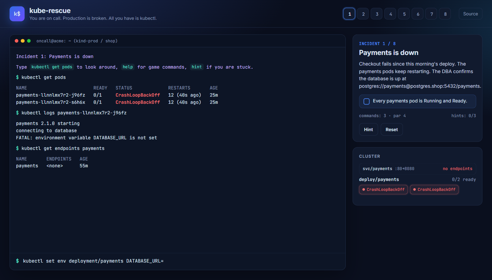
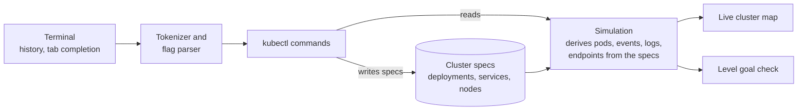

# kube-rescue

A browser game where you fix broken Kubernetes clusters with `kubectl`.

**[Play it now](https://schaib03.github.io/kube-rescue/)** · no install, no account, runs entirely in your browser.

[](https://github.com/Schaib03/kube-rescue/actions/workflows/ci.yml)


[](https://schaib03.github.io/kube-rescue/)

You are on call for a small online shop. Each incident starts with a ticket and a broken
cluster. You investigate with `get`, `describe`, `logs` and `exec`, then fix it with `set`,
`patch`, `rollout` or `scale`, the same way you would on a real cluster. The map on the
right turns green when the pods recover, and you get up to three stars depending on how
many commands and hints you needed.

## The incidents

| # | Incident | What breaks | What you learn |
| --- | --- | --- | --- |
| 1 | Payments is down | missing environment variable | `CrashLoopBackOff`, reading logs |
| 2 | The release candidate | image tag that does not exist | `ImagePullBackOff`, rolling updates, `rollout undo` |
| 3 | The worker that keeps dying | memory limit too low | `OOMKilled`, exit code 137, `set resources` |
| 4 | Nobody answers | Service selector matches no pod | endpoints, labels and selectors |
| 5 | Connection refused | wrong `targetPort` | `port` vs `targetPort`, testing from inside the cluster |
| 6 | Running, but not ready | readiness probe on the wrong path | readiness vs liveness, `patch` with strategic merge |
| 7 | Stuck in Pending | cpu request larger than any node | scheduling, requests vs limits |
| 8 | Black Friday | three problems at once | a full investigation under pressure |

Supported commands: `get` (pods, deploy, svc, endpoints, events, nodes, rs, all, with
`-o wide|yaml`, `-l`, `--show-labels`), `describe`, `logs [--previous]`, `exec -- curl`,
`top`, `set env|image|resources`, `patch`, `rollout history|undo|restart|status`, `scale`
and `delete pod`. Type `help` in the game for the rest.

## How it works



The game stores only what you can change: Deployments (with their revision history),
Services and Nodes. Everything else is **derived** from them on every read, like a
controller would: pod names come from a hash of the pod template, so changing the template
creates a new ReplicaSet with new pod names; a pod's status comes from simple rules about
its node capacity, image, environment, memory limit and probes.

- **Scheduling**: a pod whose requests do not fit on any node stays `Pending` with a
  `FailedScheduling` event.
- **Images**: an unknown tag gives `ImagePullBackOff`. A rollout to a bad image stalls
  without taking down the old ReplicaSet, as with `maxUnavailable: 25%`.
- **Containers**: a missing or invalid environment variable crashes the app, a memory
  limit below what the app needs gives `OOMKilled` (exit code 137), and both end in
  `CrashLoopBackOff`.
- **Readiness**: a probe on the wrong path or port keeps the pod out of the Service's
  endpoints.
- **Networking**: `exec -- curl` resolves the Service, checks its endpoints and its
  `targetPort` against the port the app really listens on.

After a change, new pods spend 1.5 seconds in `ContainerCreating` before reaching their
real state, which is enough to feel like a rollout.

## Design decisions

**Deterministic simulation.** Given the same specs and the same clock, the cluster always
looks the same. No randomness means levels are reproducible and can be tested.

**Every level is tested.** The test suite checks that each incident starts broken, that a
reference solution fixes it, and that plausible partial fixes do not (a memory limit just
below the need, an invalid database URL, two out of three fixes in the last level).

**Real kubectl behaviour where it matters.** `patch` implements the parts of the strategic
merge patch that matter here: maps merge, `null` deletes, and lists of containers, ports
and env vars merge by key. `set resources` refuses requests above limits with the real
error message. Output columns, ages and error strings follow kubectl.

**No framework, no runtime dependency.** Plain TypeScript and DOM: the whole game is about
50 KB of JavaScript, builds in under a second, and is served as static files from GitHub
Pages.

## Run it locally

```bash
npm install
npm run dev          # http://localhost:5173/kube-rescue/
npm test             # vitest: parser, formatting, kubectl output, every level
npm run build        # type-check and build to dist/
```

## Add an incident

An incident is an object in `src/levels/levels.ts`: a ticket, a goal, a `setup` that
builds the broken cluster, a `solved` check, three hints, a par and a reference solution.
If the failure needs a new behaviour (a new image, a new probe type), add it to
`src/cluster/images.ts` or `src/cluster/simulate.ts`. The level tests pick it up
automatically.

## Ideas

- NetworkPolicies, ConfigMaps and Secrets mounted as files, a liveness probe that restarts pods
- A free-play sandbox with a random fault
- Share links with your score

## License

MIT
